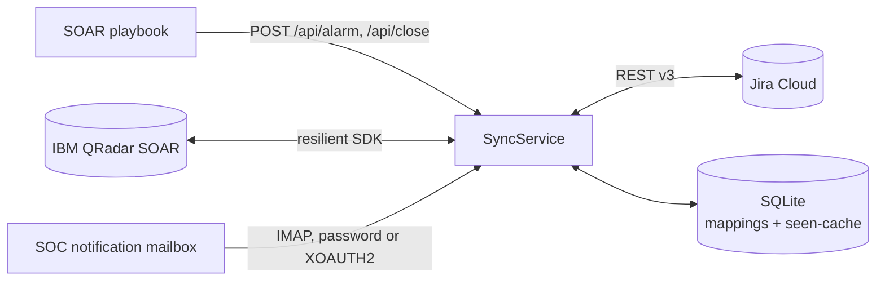

# SOAR Jira Sync

[](https://github.com/AtakanUk/soar-jira-sync/actions/workflows/ci.yml)

[](LICENSE)

A long-running service that keeps IBM QRadar SOAR incidents, Jira Cloud issues and the SOC notification mailbox in sync. It was built for an MSSP setup where the SOC works in SOAR while the customer's IT team works in Jira, and both sides need to see the same state without copy-pasting between tools.

## What it does

| Flow | Trigger | Result |
| --- | --- | --- |
| New alert | `POST /api/alarm` from a SOAR playbook, or SOAR polling finds an open incident without a mapping | Jira issue created (priority mapped from severity), Jira key written back to the SOAR incident. Repeated alerts become comments on the existing issue. |
| Status change | Jira polling sees a new status | SOAR incident status updated through the configurable status map |
| Jira closed | Issue moves to a `done` category status | SOAR incident closed with a resolution summary |
| SOAR close | `POST /api/close` or a close event | Jira issue transitioned to the first available closing transition |
| Notification mail | `<Severity> Severity Incident #<id>` mail in the mailbox | Jira issue created from the structured mail body |
| Reply mail | Mail with `Status:` / `Reason:` / `Responder:` lines | Reply added to the issue as a comment |
| Closure mail | Mail containing a closure keyword | Both Jira and SOAR closed (each side attempted independently) |

### Design notes

- **Jira is the master.** On conflicting updates the Jira state wins.
- **Loop protection.** Every mapping remembers which system made the last change (`last_sync_source`), so a change pushed from SOAR is not echoed back when it shows up in the next Jira poll.
- **Idempotency.** Alerts are correlated by SOAR incident ID, alert ID, mail Message-ID or a hash of title, timestamp and source. Correlation keys are unique in the database and also stored as a `sync-<key>` label on the Jira issue, so an issue can be re-linked even if the local database is lost.
- **Retry queue.** Failures put the mapping into `ERROR` state; every poll cycle retries them with a retry counter and gives up after five attempts.
- **Seen-cache.** A fingerprint of every polled entity (status, update time, labels...) is stored in SQLite; unchanged items are skipped, which keeps API usage low. The cache is pruned by row count and database size.
- **Operational logging.** Daily rotated logs with a total folder size limit and truncation of large payloads.

## Architecture



```text
app.py                        Flask API, polling loop, signal handling
config.py                     environment-based settings
clients/jira_client.py        Jira REST v3 (ADF bodies, transitions, retries)
clients/soar_client.py        IBM SOAR via the resilient SDK
clients/mail_client.py        IMAP reader and notification/reply parser
services/sync_service.py      all synchronization flows
services/mapping_service.py   mapping lifecycle (synced / closed / error)
services/transition_service.py  Jira transition selection
services/parser_service.py    alert payload normalization
repositories/mapping_repository.py  SQLite storage and cache pruning
utils/                        logging, retry decorator, correlation keys
deploy/soar-jira-sync.service systemd unit
```

## Requirements

- Python 3.11+
- Jira Cloud account with an API token
- IBM QRadar SOAR API key (optional; without it the service runs Jira + mail only)
- IMAP access to the notification mailbox (optional). For Microsoft 365 use `MAIL_AUTH_METHOD=oauth2` with an app registration that has the `IMAP.AccessAsUser.All` permission.

## Installation

```bash
python -m venv .venv
source .venv/bin/activate          # Windows: .venv\Scripts\activate
pip install -r requirements.txt
cp .env.example .env               # fill in the values
python app.py
```

For production, `deploy/soar-jira-sync.service` runs the service under systemd from `/opt/soar-jira-sync`.

## Configuration

Everything is configured through environment variables (or `.env`); see `.env.example` for the full list.

| Variable | Description |
| --- | --- |
| `APP_MODE` | `both` (default), `poll-only` or `api-only` |
| `APP_HOST`, `APP_PORT` | API bind address (default `0.0.0.0:8080`) |
| `APP_API_TOKEN` | Shared secret required as `Authorization: Bearer <token>` on POST endpoints |
| `JIRA_BASE_URL`, `JIRA_EMAIL`, `JIRA_API_TOKEN` | Jira Cloud credentials |
| `JIRA_PROJECT_KEY`, `JIRA_ISSUE_TYPE`, `JIRA_DEFAULT_LABELS` | Where and how issues are created |
| `JIRA_JQL_FILTER` | Custom polling query (default: whole project, latest updates first) |
| `SOAR_HOST`, `SOAR_PORT`, `SOAR_ORG`, `SOAR_API_KEY_ID`, `SOAR_API_KEY_SECRET` | SOAR connection |
| `SOAR_CAFILE` | CA bundle path, or `false` for self-signed lab instances |
| `SOAR_JIRA_FIELD_NAMES` | Incident custom fields that store the Jira key |
| `MAIL_IMAP_HOST`, `MAIL_IMAP_PORT`, `MAIL_USERNAME` | Mailbox |
| `MAIL_AUTH_METHOD` | `password` (with `MAIL_PASSWORD`) or `oauth2` (with `MAIL_OAUTH_*`) |
| `MAIL_NOTIFICATION_SENDERS` | Only these senders can create new issues |
| `MAIL_CLOSURE_KEYWORDS` | Words that mark a mail as a closure signal |
| `MAIL_PROCESSED_FOLDER` | Processed mails are moved here |
| `POLL_INTERVAL_SECONDS`, `POLL_SOAR_ENABLED`, `POLL_MAIL_ENABLED` | Polling behaviour |
| `CLOSED_STATUS_NAMES` | Fallback names used to find a closing transition |
| `DATABASE_URL` | SQLite location (default `sqlite:///data/sync_engine.db`) |
| `LOG_LEVEL`, `LOG_DIR`, `LOG_BACKUP_DAYS`, `LOG_MAX_FOLDER_BYTES` | Logging |

The Jira-to-SOAR status map (`To Do → New`, `In Progress → Active`, `Done → Closed`, …) lives in `config.py` (`SyncSettings`).

## API

| Method | Path | Body | Response |
| --- | --- | --- | --- |
| GET | `/health` | – | `{"status": "ok", "mappings": 42}` |
| GET | `/api/status` | – | totals of all, active and errored mappings |
| POST | `/api/alarm` | alert JSON | `201` with `{"action": "created", "jira_key": "SOC-123"}` or `200` for duplicates |
| POST | `/api/close` | `{"incident_id": "2001"}` | `{"action": "closed", "jira_key": "SOC-123"}` |

Example alert sent from a SOAR playbook:

```bash
curl -X POST http://sync-host:8080/api/alarm \
  -H "Authorization: Bearer $APP_API_TOKEN" \
  -H "Content-Type: application/json" \
  -d '{"incident_id": "2001", "title": "Suspicious authentication activity",
       "severity": "high", "source": "ibm-soar",
       "description": "Multiple sign-in failures followed by a successful login."}'
```

## Tests

```bash
pip install pytest
pytest
```

Unit tests run offline with mocked clients and a temporary SQLite database. They cover the sync flows (including failure handling), the Jira client, mail parsing, mappings and payload normalization. Integration tests against real systems are opt-in:

```bash
RUN_INTEGRATION_TESTS=1 pytest -m integration
```

## License

[MIT](LICENSE)
